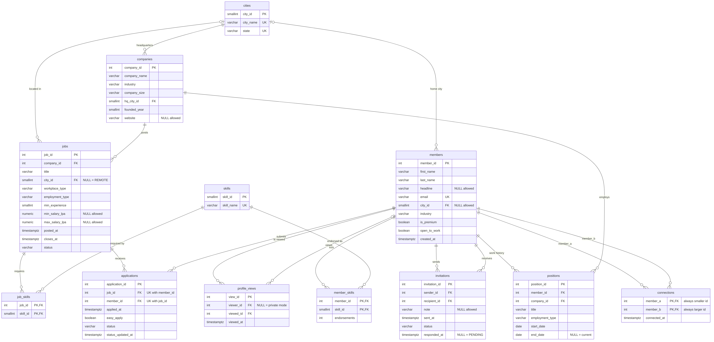
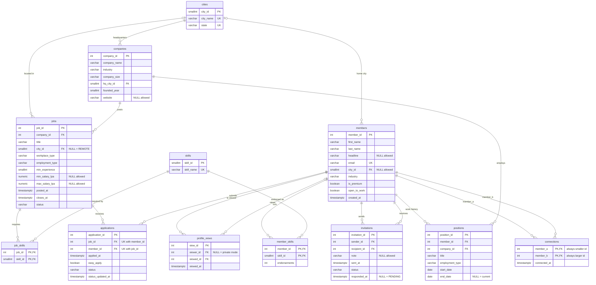

# Phase 2: Schema design (Team T0016, Section E)

Nobody gave us `CREATE TABLE` statements, only 12 CSV exports. This document explains the schema we rebuilt
from the data (`sql/01_schema.sql`), how it loads (`sql/02_load_data.sql`), and what we found in the data.

**Reproduce:**
```bash
unzip seed_data.zip                        # creates seed_data/ (CSV files are git-ignored)
createdb linkedin
psql -d linkedin -f sql/01_schema.sql      # schema "linkedin", 12 tables, constraints only
psql -d linkedin -f sql/02_load_data.sql   # \copy in FK order, ANALYZE, then the checks shown in section 9
```
Tested on PostgreSQL 16.15: both scripts run top to bottom with no errors, every row count matches the brief,
and all 30 queries of `queries/workload_30.sql` run against this schema without any change.

---

## 1. ER diagram



Image: `diagrams/er_diagram.png`. Mermaid source (paste into any Mermaid renderer to edit it):



### Relationships and cardinalities

| Relationship | Cardinality | How it is stored |
|---|---|---|
| city to member | 1 : N, optional on the member side | `members.city_id` (NULL when no location) |
| city to company (HQ) | 1 : N | `companies.hq_city_id` |
| city to job | 1 : N, optional | `jobs.city_id` (NULL for remote jobs) |
| member to position, company to position | 1 : N each | `positions` links one member to one company for a period |
| member to company (over time) | M : N | through `positions` (a member can return to a company) |
| member to skill | M : N | `member_skills`, key `(member_id, skill_id)`, carries `endorsements` |
| job to skill | M : N | `job_skills`, key `(job_id, skill_id)` |
| member to member (connection) | M : N, self-referencing | `connections`, one row per pair, `member_a < member_b` |
| member to member (invitation) | M : N, self-referencing, directed | `invitations`, `sender_id` and `recipient_id` |
| member to job (application) | M : N | `applications`, `UNIQUE (job_id, member_id)` so only 1 application per job |
| company to job | 1 : N | `jobs.company_id` |
| member to member (profile view) | M : N, directed, viewer optional | `profile_views`, `viewer_id` NULL in private mode |

There are no 1 : 1 relationships.

---

## 2. Data dictionary

Types were chosen from the data: dates without a time are `DATE`, every timestamp in the export carries the
offset `+05:30` so it is `TIMESTAMPTZ`, the `t`/`f` columns are `BOOLEAN`, salaries are `NUMERIC(5,1)` (one decimal,
3.0 to 50.0 lakh per annum, never a float), tiny lookup keys (10 cities, 72 skills) are `SMALLINT`, and the
big id columns are `INTEGER` (the largest seed id is 200,000; the large dataset stays far below 2.1 billion).
Text columns use `VARCHAR(n)` with limits well above the longest value in the data (longest first name 9,
headline 41, email 33, company name 25).

### cities (10 rows)
| Column | Type | Constraint | Why |
|---|---|---|---|
| city_id | SMALLINT | PK | 10 cities |
| city_name | VARCHAR(50) | NOT NULL, UNIQUE with state | the same name can exist in two states, so the key is `(city_name, state)` |
| state | VARCHAR(50) | NOT NULL | every city has a state |

### members (40,000 rows)
| Column | Type | Constraint | Why |
|---|---|---|---|
| member_id | INTEGER | PK | |
| first_name, last_name | VARCHAR(50) | NOT NULL, not blank | never empty in the data |
| headline | VARCHAR(220) | NULL allowed | 5,946 members never wrote one |
| email | VARCHAR(254) | NOT NULL, UNIQUE, must look like an address | sign-in identifier; 254 is the maximum email length |
| city_id | SMALLINT | FK to cities, NULL allowed | 1,231 members gave no location |
| industry | VARCHAR(50) | NOT NULL | |
| is_premium, open_to_work | BOOLEAN | NOT NULL, default FALSE | a yes/no flag must always be yes or no |
| created_at | TIMESTAMPTZ | NOT NULL, default now() | |

### companies (2,000 rows)
| Column | Type | Constraint | Why |
|---|---|---|---|
| company_id | INTEGER | PK | |
| company_name | VARCHAR(100) | NOT NULL, not unique | all 2,000 names are distinct today, but two real companies can share a name, so we do not make that a rule |
| industry | VARCHAR(50) | NOT NULL | |
| company_size | VARCHAR(12) | NOT NULL, one of 7 bands | `1-10, 11-50, 51-200, 201-1000, 1001-5000, 5001-10000, 10001+` |
| hq_city_id | SMALLINT | NOT NULL, FK to cities | every company has an HQ |
| founded_year | SMALLINT | NOT NULL, 1800 to 2100 | a year needs no more than 2 bytes |
| website | VARCHAR(255) | NULL allowed, must start with http(s):// | 400 companies have no website |

### positions (99,940 rows)
| Column | Type | Constraint | Why |
|---|---|---|---|
| position_id | INTEGER | PK | |
| member_id | INTEGER | NOT NULL, FK to members | |
| company_id | INTEGER | NOT NULL, FK to companies | |
| title | VARCHAR(100) | NOT NULL | |
| employment_type | VARCHAR(12) | NOT NULL, one of `FULL_TIME, CONTRACT, INTERNSHIP` | the only 3 values in the data |
| start_date | DATE | NOT NULL | R12 and R25 do date arithmetic, so it must be a `DATE` |
| end_date | DATE | NULL allowed, must be on/after start_date | NULL means the current position (34,238 rows) |

### skills (72 rows) and member_skills (212,417 rows)
| Column | Type | Constraint | Why |
|---|---|---|---|
| skills.skill_id | SMALLINT | PK | |
| skills.skill_name | VARCHAR(50) | NOT NULL, UNIQUE | controlled vocabulary, one row per skill |
| member_skills.member_id | INTEGER | PK part 1, FK to members | |
| member_skills.skill_id | SMALLINT | PK part 2, FK to skills | the pair is the key: a skill appears once per member |
| member_skills.endorsements | INTEGER | NOT NULL, default 0, at least 0 | a count cannot be negative (range in data: 0 to 98) |

### connections (219,966 rows)
| Column | Type | Constraint | Why |
|---|---|---|---|
| member_a | INTEGER | PK part 1, FK to members | |
| member_b | INTEGER | PK part 2, FK to members | |
| connected_at | TIMESTAMPTZ | NOT NULL | |
| (table) | | `CHECK (member_a < member_b)` | see section 3 |

### invitations (60,000 rows)
| Column | Type | Constraint | Why |
|---|---|---|---|
| invitation_id | INTEGER | PK | |
| sender_id, recipient_id | INTEGER | NOT NULL, FK to members, must differ | nobody invites themselves |
| note | VARCHAR(300) | NULL allowed | 45,168 invitations were sent without a note; the longest note in the data is 55 characters, so 300 is a generous cap |
| sent_at | TIMESTAMPTZ | NOT NULL | |
| status | VARCHAR(9) | NOT NULL, default PENDING, one of `PENDING, ACCEPTED, IGNORED, WITHDRAWN` | |
| responded_at | TIMESTAMPTZ | NULL exactly while PENDING, never before sent_at | 3,098 NULLs = the 3,098 PENDING rows |

### jobs (15,000 rows)
| Column | Type | Constraint | Why |
|---|---|---|---|
| job_id | INTEGER | PK | |
| company_id | INTEGER | NOT NULL, FK to companies | |
| title | VARCHAR(100) | NOT NULL | |
| city_id | SMALLINT | FK to cities, NULL exactly for REMOTE | 2,217 remote jobs have no city, and no other job lacks one |
| workplace_type | VARCHAR(6) | NOT NULL, one of `ONSITE, HYBRID, REMOTE` | |
| employment_type | VARCHAR(12) | NOT NULL, one of `FULL_TIME, CONTRACT, INTERNSHIP` | |
| min_experience | SMALLINT | NOT NULL, default 0, 0 to 50 | years, range in data 0 to 8 |
| min_salary_lpa | NUMERIC(5,1) | NULL allowed, positive | salary not advertised on 6,065 jobs |
| max_salary_lpa | NUMERIC(5,1) | NULL allowed, at least min, only with a min | 2,145 jobs advertise only a lower bound; a max without a min never occurs |
| posted_at, closes_at | TIMESTAMPTZ | NOT NULL, closes_at after posted_at | |
| status | VARCHAR(6) | NOT NULL, default OPEN, `OPEN` or `CLOSED` | |

### job_skills (65,719 rows)
`job_id` (INTEGER, FK to jobs) and `skill_id` (SMALLINT, FK to skills); the pair is the primary key, so a job lists a skill once.

### applications (149,984 rows)
| Column | Type | Constraint | Why |
|---|---|---|---|
| application_id | INTEGER | PK | W01 inserts an explicit id, so no identity column |
| job_id, member_id | INTEGER | NOT NULL, FKs, `UNIQUE (job_id, member_id)` | stops applying twice; W01 uses `ON CONFLICT (job_id, member_id)` which needs exactly this constraint |
| applied_at | TIMESTAMPTZ | NOT NULL | |
| easy_apply | BOOLEAN | NOT NULL, default FALSE | |
| status | VARCHAR(12) | NOT NULL, default APPLIED, one of 8 stages | `APPLIED, VIEWED, SHORTLISTED, INTERVIEW, OFFER, HIRED, REJECTED, WITHDRAWN` |
| status_updated_at | TIMESTAMPTZ | NOT NULL, not before applied_at | |

### profile_views (199,996 rows)
| Column | Type | Constraint | Why |
|---|---|---|---|
| view_id | INTEGER | PK | |
| viewer_id | INTEGER | FK to members, **must stay NULL-able**, never equal to viewed_id | NULL is how private mode is recorded: 50,173 rows (25.1%) |
| viewed_id | INTEGER | NOT NULL, FK to members | |
| viewed_at | TIMESTAMPTZ | NOT NULL | |

---

## 3. Keys and the `connections` table

**Single-column keys** are used where the CSV has its own id (`member_id`, `company_id`, ...).
**Composite keys** are used where a row has no identity of its own: `member_skills (member_id, skill_id)`,
`job_skills (job_id, skill_id)` and `connections (member_a, member_b)`.

A connection is two-way, but it must exist once. We store the pair with the smaller member id first and enforce it
with `CHECK (member_a < member_b)`. This one check does three jobs: it forbids a member connecting to themselves,
it makes (5, 9) and (9, 5) the same row so the primary key blocks the duplicate, and it matches what W03 does
(`least(...)`, `greatest(...)`). The data obeys it in all 219,966 rows.

What stops a member applying twice to one job: `UNIQUE (job_id, member_id)` on `applications` (0 duplicates in the data).

We did **not** make `invitations (sender_id, recipient_id)` unique: the data contains one pair invited twice in
the same direction and one pair invited once from each side, all ACCEPTED (check B4, section 9). A unique rule would reject real data.

## 4. Foreign keys and ON DELETE rules

| Foreign key | Rule | Reason |
|---|---|---|
| members.city_id to cities | SET NULL | removing a city should only blank the location, not delete people |
| companies.hq_city_id to cities | RESTRICT | a company must always have an HQ, so a city in use cannot be deleted |
| jobs.city_id to cities | RESTRICT | SET NULL would be rejected by `chk_jobs_remote_city` for non-remote jobs, so we block the delete instead |
| positions.member_id to members | CASCADE | a work history belongs to its member |
| positions.company_id to companies | RESTRICT | deleting a company must not silently erase talent-flow history used by R12 and R17 |
| member_skills, job_skills (both sides) | CASCADE | a link row means nothing without either parent |
| connections.member_a / member_b | CASCADE | a connection cannot outlive either member |
| invitations.sender_id / recipient_id | CASCADE | when an account is deleted its invitations go too |
| jobs.company_id to companies | CASCADE | a job posting belongs to its company page |
| applications.job_id | CASCADE | an application to a deleted job has no meaning |
| applications.member_id | CASCADE | deleting an account removes its applications |
| profile_views.viewed_id | CASCADE | views of a deleted profile are meaningless |
| profile_views.viewer_id | SET NULL | a deleted viewer becomes anonymous (same as private mode); the viewed member's history is kept |

We tested these rules in a rolled-back transaction: deleting a member removes their positions, deleting a city or a
company that is in use is refused.

## 5. NULL decisions

| Column | Empty when | Why we allow / forbid NULL |
|---|---|---|
| positions.end_date | the member still works there (34,238 rows) | NULL carries real meaning; R01 finds the current job with `end_date IS NULL` |
| invitations.responded_at | status is PENDING (3,098 rows) | enforced both ways by a CHECK: PENDING if and only if no response time |
| jobs.city_id | workplace_type is REMOTE (2,217 rows) | enforced both ways by a CHECK |
| profile_views.viewer_id | the viewer used private mode (50,173 rows) | must stay NULL-able; this is also why R13's `NOT IN` returns no rows (section 9) |
| jobs.min_salary_lpa / max_salary_lpa | salary not advertised, or only a lower bound given | a max can exist only when a min exists |
| members.headline, members.city_id | the member left it blank | optional profile fields |
| invitations.note | no personal note | optional |
| companies.website | company has no site | optional |

Everything else is `NOT NULL`: the data has no NULL there, and a missing value would make a row unusable.

## 6. CHECK constraints (25), plus 4 UNIQUE constraints

| # | Constraint | Rule |
|---|---|---|
| 1 | chk_members_names | first and last name are not blank |
| 2 | chk_members_email_shape | email has the form `x@y.z` |
| 3 | chk_companies_size | one of the 7 size bands |
| 4 | chk_companies_founded | founded_year between 1800 and 2100 |
| 5 | chk_companies_website | website starts with `http://` or `https://` |
| 6 | chk_positions_type | employment type is one of 3 values |
| 7 | chk_positions_dates | end_date is not before start_date |
| 8 | chk_member_skills_end | endorsements is not negative |
| 9 | chk_connections_order | member_a < member_b |
| 10 | chk_invitations_status | one of 4 statuses |
| 11 | chk_invitations_self | sender and recipient differ |
| 12 | chk_invitations_pending | PENDING if and only if responded_at is NULL |
| 13 | chk_invitations_order | responded_at is not before sent_at |
| 14 | chk_jobs_workplace | ONSITE, HYBRID or REMOTE |
| 15 | chk_jobs_type | employment type is one of 3 values |
| 16 | chk_jobs_status | OPEN or CLOSED |
| 17 | chk_jobs_exp | min_experience between 0 and 50 |
| 18 | chk_jobs_remote_city | REMOTE if and only if city_id is NULL |
| 19 | chk_jobs_salary_pos | salaries are positive |
| 20 | chk_jobs_salary_order | max_salary_lpa is not below min_salary_lpa |
| 21 | chk_jobs_salary_pair | a max salary needs a min salary |
| 22 | chk_jobs_dates | closes_at is after posted_at |
| 23 | chk_applications_status | one of 8 pipeline stages |
| 24 | chk_applications_dates | status_updated_at is not before applied_at |
| 25 | chk_views_self | nobody views their own profile |

UNIQUE: `uq_cities_name_state`, `uq_members_email`, `uq_skills_name`, `uq_applications_job_member`.

All constraints accept every row of the seed data. We also ran 26 invalid statements (a reversed connection, a self-invite,
a pending invitation with a response time, a remote job with a city, a duplicate application, and so on): each one was
rejected by the constraint it was meant to trigger.

**Email case:** all 40,000 emails contain upper-case letters (for example `...@Gmail.com`) and the 40,000 values are
still distinct after `lower()`. `UNIQUE (email)` is case-sensitive, and R23 searches with `lower(email)`, so it cannot use that index.
A case-insensitive unique index on `lower(email)` is an optimization for Phase 4, not part of this schema.

## 7. Indexes that exist after Phase 2

Only the indexes PostgreSQL builds for PRIMARY KEY and UNIQUE exist (16 in total):

| Table | Indexes |
|---|---|
| applications | `applications_pkey (application_id)`, `uq_applications_job_member (job_id, member_id)` |
| cities | `cities_pkey`, `uq_cities_name_state (city_name, state)` |
| companies | `companies_pkey` |
| connections | `pk_connections (member_a, member_b)` |
| invitations | `invitations_pkey` |
| job_skills | `pk_job_skills (job_id, skill_id)` |
| jobs | `jobs_pkey` |
| member_skills | `pk_member_skills (member_id, skill_id)` |
| members | `members_pkey`, `uq_members_email (email)` |
| positions | `positions_pkey` |
| profile_views | `profile_views_pkey` |
| skills | `skills_pkey`, `uq_skills_name (skill_name)` |

PostgreSQL does **not** index foreign-key columns, so `positions.member_id`, `applications.member_id`, `invitations.recipient_id`,
`profile_views.viewed_id` and others have no index. A composite key helps only its leading column: `connections` is indexed on
`member_a` but not on `member_b`. These are the starting points for Phase 4.

## 8. Functional dependencies and normal forms

A table is in 3NF if every non-key column depends on the key, the whole key and nothing but the key. It is in BCNF
if every determinant is a candidate key. We list the dependencies we found in each table:

| Table | Functional dependencies | Normal form |
|---|---|---|
| cities | city_id to city_name, state; (city_name, state) to city_id | BCNF (both determinants are candidate keys) |
| members | member_id to all columns; email to member_id (and so to everything) | BCNF |
| companies | company_id to all columns | BCNF. The city is reached through hq_city_id, not repeated |
| positions | position_id to all columns | BCNF. `title` does not determine any other column |
| skills | skill_id to skill_name; skill_name to skill_id | BCNF |
| member_skills | (member_id, skill_id) to endorsements | BCNF (the only determinant is the key) |
| connections | (member_a, member_b) to connected_at | BCNF |
| invitations | invitation_id to all columns | BCNF. `status` and `responded_at` are tied by a rule (check 12), but neither determines the other: ACCEPTED, IGNORED and WITHDRAWN all have a response time |
| jobs | job_id to all columns | BCNF. `company_id` does not repeat any company data |
| job_skills | (job_id, skill_id), all columns are key | BCNF |
| applications | application_id to all columns; (job_id, member_id) to all columns | BCNF (two candidate keys) |
| profile_views | view_id to all columns | BCNF |

The schema is in 1NF as well: every value is atomic (no lists inside a column; many-to-many data lives in link tables) and
every table has a primary key. Because every table has only candidate keys as determinants, no table needs splitting.

One thing we looked at and kept: `industry` is stored as text in both `members` and `companies` (10 values), and
`title` as text in `jobs` and `positions`. A lookup table would be possible, but no column depends on `industry` or `title`,
so this is not a 3NF problem, and the queries filter on the text (R19 uses `c.industry = 'IT Services'`).

### Derived or redundant columns

| Question from the brief | Answer |
|---|---|
| Is a member's current company derived from `positions`? | Yes: it is the row with `end_date IS NULL`. There is no `current_company` column in `members`, which is right, because a stored copy could disagree with `positions`. No member has more than one current position (check A2), and 5,762 members have none. |
| Is `members.headline` redundant with the current position? | No. It is free text written by the member, ending in one of 4 generic phrases (for example "at a bank"). Only 983 of the 29,151 members who have both a headline and a current position write the position title in their headline. It cannot be derived, so we keep it. |
| Is `members.industry` the industry of the current company? | No. It matches the current company's industry for only 3,456 of 34,238 members (10%, as random). It is an independent attribute. |
| `jobs.status` could be derived from `closes_at` | In principle, but a stored value is needed: "closed" depends on the current time, which an index cannot use (`now()` is not allowed in an index predicate), and R06, R07 and R19 all filter on `status = 'OPEN'`. The nightly job W04 keeps it up to date. 552 jobs are still OPEN with a past `closes_at` (the jobs W04 would close). We keep it stored. |
| `member_skills.endorsements` | A stored counter. The individual endorsements are not in the export, so it cannot be derived. Kept. |
| Connections vs ACCEPTED invitations | A connection should exist exactly when an invitation was accepted (W02 and W03 do both steps). The seed data does not follow this (section 9, B2 and B3), so we treat them as two separate facts and do not add a constraint. |

## 9. Load results, integrity checks and data problems

### Row counts (output of `02_load_data.sql`)
All 12 tables match the brief: cities 10, members 40,000, companies 2,000, positions 99,940, skills 72,
member_skills 212,417, connections 219,966, invitations 60,000, jobs 15,000, job_skills 65,719,
applications 149,984, profile_views 199,996. The load took about 11 seconds and produced no error.

### Integrity checks (violations = 0 means the rule holds)
| Check | Violations |
|---|---:|
| A1 a member has two overlapping positions | 0 |
| A2 a member has more than one current position | 0 |
| A3 an application was sent before its job was posted | 0 |
| A4 a job requires no skill at all | 0 |
| **B1** application sent **after** the job's `closes_at` | **14,574** |
| **B2** ACCEPTED invitation with no row in `connections` | **36,157** (of 36,169 accepted) |
| **B3** connection with no ACCEPTED invitation | **219,954** (of 219,966) |
| **B4** pair of members invited more than once | **2** |
| **B5** OPEN job whose `closes_at` is before 2026-07-01 | **552** |
| **B6** CLOSED job whose `closes_at` is on/after 2026-07-01 | 0 |
| **B7** invitation sent before the sender joined | **681** |
| **B8** application sent before the member joined | **1,695** |
| **B9** profile viewed before the viewed member joined | **2,358** |
| **B10** connection made before either member joined | **109,392** |
| **B11** position started before the company's founding year | **11,353** |

A is a rule the data respects. B is a rule we expected and the data breaks.

### Data problems found, and what we did
Our constraints accept all rows. Where the data breaks a business rule that a `CHECK` cannot or should not enforce, we kept
the rows unchanged (the project forbids editing data) and recorded the problem here.

1. **Applications after the closing date (B1, 14,574 rows).** Up to 25 days after `closes_at` (13,995 on jobs now CLOSED, 579 on OPEN ones).
   `closes_at` therefore looks like an advertised date, not a hard stop. A cross-table rule needs a trigger, and a trigger would reject real data, so there is no constraint.
2. **Connections and invitations are not linked (B2, B3).** Only 12 of 36,169 accepted invitations have a connection row, and almost no connection has an accepted invitation.
   The two tables look generated independently. No foreign key or constraint can join them.
3. **Re-invitations (B4).** One pair was invited twice in the same direction (invitations 29989 and 39307, members 39514 to 347, both ACCEPTED) and one pair invited each other (7814 and 34376, members 36610 and 19212, both ACCEPTED). We therefore do not make `(sender_id, recipient_id)` unique.
4. **Timeline inconsistencies (B7 to B11).** Invitations, applications, views and connections that happen before a member's `created_at` (681, 1,695, 2,358, 109,392 rows), and positions that start before the company's founding year (11,353). Positions before `created_at` are normal (work history predates joining), so that one is not counted as a problem. The others are generated-data effects; no constraint, because the right fix is in the source system.
5. **Stale job status (B5, 552 rows).** Jobs still OPEN after `closes_at`; W04 is the query that closes them.
6. **Case in emails.** Every email has upper-case letters; they are unique even in lower case. See section 6.
7. **The NULL trap in R13.** `profile_views.viewer_id` contains NULL (private mode). R13 uses `NOT IN (SELECT viewer_id ...)`: when the list contains a NULL, `NOT IN` never evaluates to true, so R13 returns **0 rows**.
   The real answer is **6,513 members** who never viewed anyone (found with `NOT EXISTS`). This is the "empty list" in problem P5. We keep `viewer_id` nullable (it must be) and will fix the query in Phase 4.
8. **Empty strings versus NULL.** The CSVs mark an empty value by nothing at all (`,,`); `\copy ... csv` loads that as NULL, which is what we want. No column contains an empty string.

## 10. Notes for the next phases
- Foreign-key columns are not indexed (section 7). That is deliberate for the baseline in Phase 3.
- R15 (`EXTRACT(YEAR ...)`) and R20 (`applied_at::date`) depend on the session `TimeZone`, because the columns are `TIMESTAMPTZ`.
  We will run every benchmark with the same time zone (set `PGTZ=Asia/Kolkata`) so results stay comparable.
- For the large dataset only the folder name in `02_load_data.sql` changes; the schema is reused unchanged.
